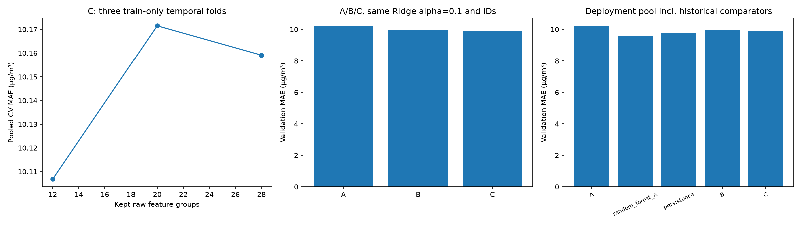

# T12 — Ablation A/B/C và khóa phương án trên dữ liệu phát triển

Issue #24, nhánh `feature/t12-feature-ablation`; T11/PR #23 đã merge.
Mục tiêu RQ2: lượng hóa đóng góp history PM2.5 và thử chọn feature, giữ tham số
mô hình nhất quán; không coi chọn feature/tuning luôn giúp, không mở test/T13.

## Thiết kế chốt trước thực nghiệm

[ablation.json](../configs/ablation.json) và Issue #24 ghi trước run:

- Model chính **Ridge alpha=0.1**, từ train CV T11; A tham chiếu full refit
  `32e65c5a4cbc489c905cf146b743867f`, không xóa/run lại A khi artifact hợp lệ.
  A/B/C cùng imputer/indicators/encoder/scaler T08, cùng Ridge parameters,
  seed thực None (project42), identity output, không clipping.
- A20 feature gồm số đo t, station/wd, lịch t+1 và sin/cos T07. B33 thêm
  lag PM2.5 t−1/3/6/12/24h và rolling mean/std3/6/12/24h kết thúc t,
  `min_periods=window`, std ddof1; giữ missing history/warmup để impute trong fit.
- Train B tái sử dụng [manifest T07](../reports/features_full/feature_manifest.json),
  kiểm hash/size/schema/IDs và A bằng số đo T05 tới sai số round-trip CSV1e-12.
  Không tái ghép raw hoặc làm lại phần T07 đúng. B lấy từ timeline quan trắc,
  gồm origin từng bị loại khỏi supervised vì target thiếu, không chỉ rows train.
- Validation B dùng history PM2.5 có thật từ loader T04 bounded prefix T09
  đến origin validation cuối, không parse CSV/IDs test. Raw toàn file chỉ hash
  để xác minh identity, không dùng số đo tương lai. Weather/wd chỉ cần tại
  requested origins, lấy từ T05 đã xác minh; NA weather ở history không được
  coi là số đo thật và không dùng trong lag/rolling PM2.5. A/B từ history này
  được kiểm nhất quán. Quan sát validation <=origin được phép theo rolling t+1.
- C dùng **grouped SelectFromModel-style với pilot Ridge**, sau preprocessing.
  Mỗi feature gốc B là một nhóm: numeric và missing indicator đi cùng nhau;
  station/wd giữ toàn bộ dummy one-hot cùng nhóm. Sin/cos mỗi cột là một nhóm
  riêng theo registry T07, không tạo nhóm mới sau khi nhìn metric.
- Pilot alpha0.1 fit trong train fold, điểm nhóm `sqrt(mean(coef²))`, top k theo
  điểm giảm dần, tie theo registry. C giữ nhóm nguyên khối; số chiều encoded
  có thể lớn hơn k vì one-hot/indicator. Điểm RMS tránh tổng điểm tự tăng chỉ
  do có nhiều dummy, nhưng không làm score bất biến với encoding/scale.
- Search k **{12,20,28}** qua đúng ba expanding-window T11, unique target
  timestamps/ranh giới chung trạm, purge strict label<first eval origin.
  Mỗi fold fit lại imputer/encoder/scaler/pilot/selector/final Ridge; không
  chọn nhóm trên toàn train trước CV. OOF IDs giống nhau cho mọi k.
- Chọn k bằng pooled MAE trong train CV; tie1e-12 ít nhóm hơn. Persist
  selection trước đọc validation. Sau đó fit final B và C trên toàn primary
  train, chấm validation cùng IDs với A. Không tune riêng model trên từng bộ.

Ngân sách full: **9 pipeline fits CV** =9pilot+9final Ridge fits; final B1
estimator và C2 (pilot+final), tổng tối đa **21 estimator fits**, 2 validation
pipeline fits. Không fit thêm A hoặc RF. Smoke k20×3fold, head64fit/16eval mỗi
trạm trong cửa sổ; không validation/refit hoặc dùng kết luận chính. Một full
search, không retry tự động, không đổi grid sau score, BLAS1/chạy tuần tự.

Để khóa phương án có ích, pool deployment gồm A/B/C mới/đã reuse cùng với
**RF A T10** `780ecb7fb59d48bea58d5e4a076f1f26` và **persistence T09**
`24cef47874a94d9faa7bfcbae29b5c58` đã có prediction thật. Hai đối chứng lịch sử
không fit thêm; việc đối chiếu và ngân sách0 được khai báo trước run, không
phải chạy thêm model thứ hai. Chọn MAE validation nhỏ nhất; tie1e-12 theo
A, RF_A, B, C, persistence. Không đổi ưu tiên sau khi xem kết quả.

## Kết quả thực tế và trả lời RQ2

Smoke parent 1ee4f2f0e07948a187f5889b042df812; full parent 0a616a9fb5134058b3af3cafb1a70e18.
B full 48d2f03be4614a25906f84d98df9e9dc; C full 3a9f2500e4dd4ef28d7bc20def6f79c8.
Full có 15 hồ sơ (search1/candidate3/fold9/final2); smoke có5. Toàn bộ20
hồ sơ T12 completed; không có candidate lỗi thật. Index49 dòng giữ nguyên29
hồ sơ T09–T11, không gọi49 dòng là49 model độc lập.

| k nhóm | Pooled CV MAE | Pooled CV RMSE | Pooled CV R² | Fold MAE mean ± std |
| --- | ---: | ---: | ---: | --- |
| 12 (chọn) | 10,106828 | 17,727766 | 0,949042 | 10,125542 ± 1,188526 |
| 20 | 10,171504 | 17,567402 | 0,949960 | 10,190435 ± 1,202549 |
| 28 | 10,159104 | 17,572611 | 0,949931 | 10,178662 ± 1,243861 |

Mỗi k cùng 76.102 OOF sample IDs, cùng ba fold T11. k12 chọn theo MAE;
k20 có RMSE CV thấp hơn nhưng không đổi criterion sau metric. Mean/std
RMSE và R² đầy đủ ở [candidates.csv](../reports/ablation/candidates.csv),
metric/N/thời gian từng fold ở [fold_metrics.csv](../reports/ablation/fold_metrics.csv).

| Phương án | Raw groups giữ | Chiều model | Validation MAE | RMSE | R² | Dự báo âm |
| --- | ---: | ---: | ---: | ---: | ---: | ---: |
| Ridge A (T11 reuse) | 20 | 65 | 10,200529 | 18,907198 | 0,946702 | 2684 |
| Ridge B | 33 | 91 | 9,968755 | 18,467071 | 0,949154 | 2380 |
| Ridge C | 12 | 24 | 9,903377 | 18,501063 | 0,948967 | 1473 |
| RF A (T10 reuse) | 20 | 65 | 9,561488 | 18,964825 | 0,946376 | 0 |
| Persistence (T09 reuse) | — | — | 9,736617 | 19,240919 | 0,944804 | 0 |

[Bảng từ artifact](../reports/ablation/comparison.csv), cùng 102.479 primary
validation IDs, coverage100%; MAE/RMSE µg/m³, R² không đơn vị. A/RF/persistence
được tính lại từ prediction thật đã có, không gán timing của T12 cho run cũ.

| Ridge | Train MAE | Train RMSE | Train R² | Fit final pipeline (s) | Predict validation (s) |
| --- | ---: | ---: | ---: | ---: | ---: |
| A | 11,286262 | 19,923719 | 0,936180 | 1,771478 | 0,413035 |
| B | 11,072109 | 19,568182 | 0,938437 | 1,843940 | 0,354705 |
| C | 11,107759 | 19,789072 | 0,937039 | 1,711407 | 0,288522 |

Train là lỗi in-sample. Timing A là lượt T11 cũ, B/C là lượt T12; không là
benchmark kiểm soát môi trường. C fit gồm cả pilot+final; full parent wall
time67,370747s gồm CV/validation/I/O/logging, không gồm preflight trước start_run.



Hình gồm chọn k bằng CV, A/B/C cùng Ridge alpha0.1 và toàn pool deployment;
không chứa smoke/test. Chỉ mục: comparison.png, nguồn candidates.csv và
comparison.csv cùng full parent/run IDs nêu trên.

- **RQ2, A→B:** MAE giảm 0,231774 µg/m³
  (2.2722%), RMSE cũng giảm. Với Ridge alpha0.1 trên split này, lịch sử
  PM2.5 nhân quả có ích hơn chỉ đo hiện tại/lịch; không suy là đúng mọi model.
- **RQ2, B→C:** MAE giảm thêm 0,065379 µg/m³
  (0.6558%), chiều model91→24. Tuy vậy RMSE tăng
  0,033993; selection không thắng mọi metric. Std fold không là confidence
  interval và các fit windows chồng lấn; chưa kiểm định độ ổn định độc lập.
- C final giữ 12 nhóm: PM2.5, PM10, TEMP, PRES, DEWP, RAIN, WSPM,
  target_hour_sin, target_month_cos, pm25_lag_1h, pm25_roll_mean_3h,
  pm25_roll_mean_6h. Mỗi nhóm numeric kèm indicator nên thành24 chiều.
  Station/wd và mọi dummy của chúng bị bỏ nguyên khối. Danh sách giữ/bỏ,
  group score và khác biệt giữa fold ở [selected_features.csv](../reports/ablation/selected_features.csv).
  Không suy rằng feature bị bỏ vô ích vật lý hoặc không giúp model khác.
- B/C vẫn kém persistence về MAE; RF A T10 vẫn tốt nhất pool theo MAE9,561488.
  B có RMSE tốt nhất pool nhưng MAE là tiêu chí đã chốt, nên **khóa RF A**:
  80 cây/depth12/min leaf2/max_features1/seed42/n_jobs1, preprocessing T08
  không scale numeric RF, A20 cột, identity output. Không chạy lại RF.
- C giảm số chiều đưa vào model nhưng vẫn tạo/preprocess toàn B trước mask;
  chưa chứng minh giảm tổng chi phí tạo feature/inference. Hệ số pilot phụ
  thuộc scale/one-hot/indicator và tính tương quan; không là causal importance.
- Quyết định này chỉ dựa dữ liệu phát triển và giữ nguyên kết quả bất lợi;
  chưa xem test hoặc refit train+validation. Frozen config trỏ provenance và
  split manifest T05 bất biến, giữ horizon1 và test gate. Chỉ khi được giao T13
  mới tạo model weights cuối và đánh giá độc lập; không có weights deploy sẵn.

## Code, log, frozen config và tái kiểm

[Grouped selector](../src/beijing_air/feature_selection.py),
[data/decision helpers](../src/beijing_air/ablation.py),
[CLI](../scripts/run_ablation.py), [verifier](../scripts/report_ablation.py).
Giữ logger cũ: parent search→candidate→fold, parent→B/C final; kind
feature_selection/ablation và parameters.stage. Artifact mỗi fold có giữ/bỏ
nhóm, group scores/pilot coefficients, encoded names, chiều model và median/
scaler/categories đã fit, metrics/time/predictions. Fold lỗi giữ error/status,
candidate thiếu fold completed bị loại, không chấm phần fold còn lại.

```powershell
.\.venv\python.exe scripts/run_ablation.py --mode smoke
.\.venv\python.exe scripts/run_ablation.py --mode full
.\.venv\python.exe scripts/report_ablation.py --write-report
.\.venv\python.exe -m pytest tests/test_ablation.py -q --basetemp=.pytest_cache/t12-check
.\.venv\python.exe -m pytest tests -q -k "not test_saved_full_output_matches_audit_and_raw_checksums" --basetemp=.pytest_cache/t12-regression
```

Runner reuse completed cùng source/config/data signature sau kiểm hashes;
chặn full khác config hoặc sau full thất bại, không xóa lịch sử vượt budget.
Tài nguyên thiếu thì dừng trước fit, không tự subsample và gọi là full.
Verifier không fit: kiểm hierarchy/CSV links/source SHA/IDs/purge, median/
scaler từ fit rows, điểm nhóm từ pilot coef đã lưu, mask nguyên nhóm, metrics
OOF/mean/std, selected k, A/B/C cùng IDs và quyết định frozen đúng tiêu chí.

Frozen config ở `reports/ablation/frozen_model.json` và artifact parent ghi
data/split/provenance, feature recipe, preprocessing, model/actual parameters/
seed, identity postprocessing, criterion/pool/scores và run IDs. Đây là **khóa
công thức cho lần refit tương lai, chưa là model có weights để deploy**.
Chỉ khi T13 được giao mới refit train+validation rồi test; C nếu được chọn sẽ
refit selector với k/phương pháp cố định, subset thực tế có thể đổi khi thêm
validation. Không dùng test để chọn lại k/model hoặc hậu xử lý.

Hồ sơ thật được track trực tiếp, không ZIP mới. Clone mới restore riêng hai
tree T09 từ bundle sẵn có như [T10](initial_findings.md), giữ index hiện tại,
không thay CSV bằng index cũ. Summary/pilot coefficients không phải pipeline
serialized để inference; save/load/clone được kiểm với fixture TEST_ONLY.

## Kiểm tra đã chạy

Riêng T12 **12 passed** sau khi tích hợp verifier: grouped masks giữ nguyên
one-hot/indicator, causal PM history với giờ khuyết/NA/future mutation, unknown
category, clone/save-load/names, fitted state không đổi khi transform holdout,
budget/reuse/selection khóa trước đọc validation, thất bại candidate/fold vẫn
giữ metadata/error và mọi candidate lỗi không được đọc validation.
Fixture/source tham chiếu ghi rõ TEST_ONLY, không vào index chính thức.

Regression cuối **243 passed, 1 deselected** với lệnh ở trên. Ca T04 raw/full
có phần test bị loại. Smoke/full verifier đều PASS cho source/artifact hashes,
CSV links, IDs/purge, median/scaler từ fit rows, pilot group scores/mask,
OOF mean/std, A/B/C cùng IDs và frozen params/criterion. Đã xem PNG trực tiếp;
nhãn/đơn vị và bảng khớp artifact. Chưa cấu hình CI, đây là kiểm tra local.

Lỗi fixture ban đầu truyền string vào hàm checksum cần Path đã được sửa;
sau đó unit/verifier/regression pass. Không có failed candidate thật trong
hai lượt T12; các lỗi tiêm chỉ để kiểm logger/budget, không dựng lịch sử model.
T01–T11 và 29 dòng index cũ được giữ, source snapshots bảo toàn bytes nguyên
gốc (kể cả CRLF của file cũ) để staged Git blobs khớp SHA đã ghi khi chạy.

## Hạn chế cần giữ khi diễn giải RQ2

A/B là ablation tại alpha cố định chọn trên A, không so phương án tối ưu riêng
cho từng feature set; giữ alpha giúp quy chênh lệch cho đổi feature/pipeline,
nhưng có thể bất lợi cho B/C. C là thử nghiệm selection có ngân sách nhỏ, không
chứng minh subset tốt nhất. Các lag/rolling tương quan mạnh, score hệ số có
thể chuyển giữa feature thay thế nhau và giữa fold; không diễn giải là nguyên
nhân hay tầm quan trọng vật lý. OHE không scale trong T08, numeric có scale,
indicator0/1 và chuẩn hóa theo số cột làm score phụ thuộc cách mã hóa/nhóm.

CV dùng lại ba cửa sổ T11 đã chọn alpha, không nested CV. Score dùng chọn k
không phải ước lượng độc lập không thiên lệch sau hai bước lựa chọn.

Validation được dùng nhiều lần ở T09–T12 để phát triển/chọn phương án;
có rủi ro overfit dữ liệu phát triển. Chưa có ước lượng cuối độc lập hoặc
bảo đảm cải thiện trên test. Primary cần PM2.5(t) và target quan sát, không
đại diện toàn operational/missing. Chưa test/T13, weights triển khai, demo,
DOCX/PPTX hay kiểm máy sạch. Git dirty lúc chạy trước commit là trạng thái
thật; source snapshots/hash liên kết mã đã chạy, không gán ngược commit.
