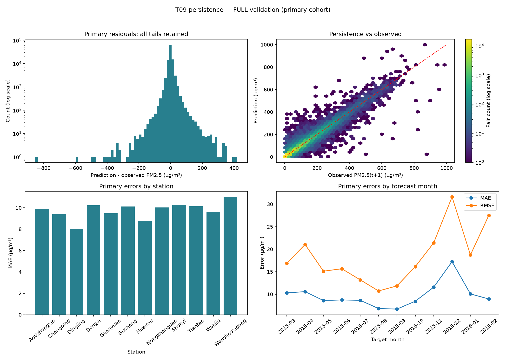

# T09 — Persistence baseline và Experiment Log thực tế

Issue #18; T08/PR #17 đã merge. Đã chạy **một smoke rồi một full** ngày
02/11/2026, chỉ validation, không mở test. Source:
[baseline.py](../src/beijing_air/baseline.py), [metrics.py](../src/beijing_air/metrics.py),
[evaluation.py](../src/beijing_air/evaluation.py),
[runner](../scripts/run_baseline.py), [verifier/bundler](../scripts/verify_baseline.py).

Mục tiêu: xác định mốc MAE/RMSE/R² cho PM2.5 đúng t+1 cùng trạm, không buộc
Ridge/Random Forest phải thắng. T09 chưa chạy model ML, tuning hoặc test.

## Protocol chốt trước khi xem metric

[baseline.json](../configs/baseline.json) và Issue #18 ghi trước khi chạy:

1. Có PM2.5(s,t): dự báo bằng đúng số đo đó.
2. Nếu thiếu: lấy PM2.5 quan sát gần nhất cùng trạm với timestamp ≤t và tuổi
   **≤24 giờ, inclusive**, tính từ origin t, không từ target t+1.
3. Quá tuổi/không có history: median trạm từ PM2.5(t) của origin train T05;
   nếu không có thì median toàn origin train.
4. Nếu mọi nguồn đều thiếu: unavailable, giữ ID và báo coverage, không âm
   thầm bỏ mẫu để giảm metric.

Giới hạn một ngày nhất quán phạm vi history 24h T07, không chọn sau khi thử
metric validation/test. Không điều chỉnh nó sau khi xem kết quả dưới đây.
Không smoothing, clipping hoặc impute target.

Median học trên **205.977 operational train origins**, bỏ qua PM2.5 NA
(204.865 giá trị quan sát). Global median=61 µg/m³, median trạm 45–68;
state lưu ở `model/baseline_state.json`. Không dùng median holdout/target.
Lịch sử lấy từ prefix quan trắc T04, không chỉ rows supervised T05: origin
bị loại do target thiếu vẫn có thể cung cấp số đo cho fallback sau đó.

Loader T04 chỉ parse giá trị tới origin validation cuối **2016-02-29 22:00**,
hash toàn raw để xác minh identity, không mở CSV/IDs test hoặc ghi lại
raw/merged/audit T04. Prefix UCI phải khớp timeline đều đã audit; dừng nếu
lệch. Predictor tra timestamp/asof backward riêng trạm, hỗ trợ gap, không
tính tuổi bằng số dòng. Số đo tới t đã sẵn sàng theo T02; quan trắc mới
trong rolling validation chỉ được dùng khi tới origin, không dùng y(t+1).

## Validation IDs cố định cho model sau

[validation_manifest.json](../reports/evaluation/validation_manifest.json)
được tạo trước metric, tham chiếu chính ID files T05, lưu SHA-256, số mẫu
và digest ID có thứ tự; không tạo kho ID song song.

| Cohort | N | Quy tắc |
| --- | ---: | --- |
| Primary — headline | 102.479 | PM2.5(t) và target t+1 đều quan sát |
| Operational — bổ sung | 103.287 | Mọi target hợp lệ, kể cả PM2.5(t) thiếu |

Target full: **2015-03-01 00:00 → 2016-02-29 23:00**;
origin: **2015-02-28 23:00 → 2016-02-29 22:00**, giờ nguồn local-naive.
Train target cuối 2015-02-28 23:00 đã sẵn sàng tại origin validation đầu
cùng giờ, đúng holdout rule T05. Không đổi mốc split chung giữa các trạm.

Primary ordered-ID SHA-256:
`534385085c4feed8d9eea8bbb1d2ec2942c5675c96f7fc2f9bb1dd3f394dd5d7`.
Operational:
`bd15e19b4ce89a5025e5f36f547fc4d3f56953e334d38da3bc8390270dd6444a`.
T10 phải dùng đúng primary IDs/order, không drop thêm vì feature thiếu.
Operational nếu đánh giá phải báo riêng cùng IDs/coverage; không so hai
mẫu số như cùng một tập.

`load_train_validation` chỉ xác minh train/validation; `freeze_validation_ids`
từ chối thay anchor/cohort. `regression_metrics` và `grouped_metrics` là
hàm dùng chung cho model sau. Wrapper `evaluate_predictions` của baseline
kiểm operational IDs/order và thêm tỷ lệ fallback persistence. MAE,
sqrt(MSE), R² tính trên toàn cohort, không lấy trung bình R² từng trạm.
Unavailable phải báo coverage; target thiếu/inf hoặc sai ID bị từ chối.
R² không xác định trả null và lý do, không ép thành 0/1.

## Run thực tế và kết quả full

| Run | ID | Vai trò / UTC ngày 02/11/2026 |
| --- | --- | --- |
| Smoke | `5a6c965f64754a2ea9508e554fd92092` | 13:47:35.785831 → 13:47:38.298043; 2.016 operational/1.998 primary; không là số liệu chính thức |
| Full | `24cef47874a94d9faa7bfcbae29b5c58` | 13:50:16.657110 → 13:50:21.675943; reference smoke để kiểm thực thi, không so metric smoke/full như cải tiến |

**Metric full chính thức:**

| Cohort | N scored | MAE (µg/m³) | RMSE (µg/m³) | R² | Fallback | Coverage |
| --- | ---: | ---: | ---: | ---: | ---: | ---: |
| Primary | 102.479 | **9,736617** | **19,240919** | **0,944804** | 0 | 100% |
| Operational | 103.287 | 9,903556 | 20,060564 | 0,939982 | 808 (0,782286%) | 100% |

Nguồn:
[metrics.csv](../reports/baseline/full/24cef47874a94d9faa7bfcbae29b5c58/metrics.csv),
[fallback.csv](../reports/baseline/full/24cef47874a94d9faa7bfcbae29b5c58/fallback.csv),
[run pointer](../reports/baseline/full/24cef47874a94d9faa7bfcbae29b5c58/run.json),
[Experiment Log](../experiments/experiment_log.csv).

Operational gồm 102.479 persistence, **805** latest-history (tuổi 1–24h),
**3** median-trạm (last reading tuổi 29–167h). Global/unavailable không phát
sinh trong run thật, đã được unit test. Rate có mẫu số toàn operational.

Actual seed=null vì không dùng RNG; project seed=42 giữ trong config cùng
randomness_used=false. `config.mode` là mode thực của run; `parameters.project_config`
giữ snapshot config gốc (default smoke), được CLI `--mode full` ghi đè ở
mode thực thi, không dùng trường snapshot đó để phân loại kết quả.
Full logger duration=**5,018833s**; fit fallback
statistics 0,071403s, predict 1,369119s, evaluate 0,137760s, diagnostics/plot
1,574664s. Timer preflight/khởi tạo 8,717572s đo từ vào runner tới trước fit,
có phần trùng logger initialization: **không cộng với duration** để gọi là
tổng. Thời gian chỉ mô tả lần chạy này, chưa là benchmark model công bằng.

## Nhận xét và đề xuất T10



Hình gốc 150 dpi dùng full primary, giữ mọi đuôi. Residual=`y_pred−y_true`,
âm là dự báo thấp. Histogram có log count; hexbin có đường identity;
hai panel cuối dùng bảng
[trạm](../reports/baseline/full/24cef47874a94d9faa7bfcbae29b5c58/station_metrics.csv)
và [tháng target](../reports/baseline/full/24cef47874a94d9faa7bfcbae29b5c58/month_metrics.csv).

- Từ predictions primary: median absolute error=5, Q90=22, Q95=33,
  Q99=73 µg/m³. RMSE gần gấp đôi MAE cho thấy đuôi lỗi lớn có ảnh hưởng;
  R² cao không đồng nghĩa mọi giờ đều dự báo sát.
- Residual mean −0,103428 µg/m³, gần cân bằng tổng thể nhưng có dự báo thấp
  lớn. Max absolute error **853 µg/m³**, Dingling origin 2016-02-08 00:00:
  persistence=28, thực tế t+1=881. Hai trạm khác có lỗi lớn cùng origin,
  xem [20 lỗi lớn](../reports/baseline/full/24cef47874a94d9faa7bfcbae29b5c58/largest_errors.csv).
  Chưa xác minh sensor/cơ chế bên ngoài; không suy nguyên nhân hoặc xóa đợt
  cao để metric tốt hơn.
- Primary MAE theo trạm từ **7,9912** (Dingling) tới **10,9877**
  (Wanshouxigong); theo tháng thấp nhất **6,7073** (2015-09), cao nhất
  **17,2363** (2015-12). Đây là khác biệt mô tả, không chứng minh nhân quả
  hoặc ý nghĩa thống kê; số mẫu/phân phối các nhóm khác nhau.

T10: Ridge/RF A với preprocessing T08 fit đúng train, cùng 102.479 primary
IDs và policy identity; so MAE chính, RMSE/R² bổ sung, chi phí/coverage và
nhóm lỗi. Ghi cả trường hợp kém baseline; chưa khẳng định ML sẽ dự báo được
bước nhảy lớn. T09 không triển khai T10 hoặc thử thêm tuning/selection.

## Logger và bundle bàn giao

Tái sử dụng logger T04-LOG. Mỗi run có config/metrics/metadata/notes, source
snapshots, baseline median state, validation anchor/selected IDs, predictions,
tables và PNG. Predictions giữ ID, trạm/origin/target, is_primary/split,
y_true/y_pred, nguồn/tuổi fallback, residual/error và run_id. Logger lưu
start/end/status/Git/environment/artifact SHA, giữ error khi exception.

Thực thi trước commit: Git parent
`8c9f98d07bcdd5d3b237fa2438c571b0a09f20e3`, branch T09, dirty=true ghi đúng.
Bốn file scientific/runner được snapshot/hash và khớp source bàn giao. Sau
run bổ sung guard ở logger: CSV có run nhưng thiếu config/metrics/metadata/
notes thì không cho start mới làm rơi lịch sử. Guard không đổi metric/run
cũ; không giả rằng nó đã được dùng trong hai run trước đó. Source thực chạy
truy vết qua Git parent và snapshots.

Run trees mặc định ignore. Bundle thật
[t09_runs.zip](../reports/baseline/t09_runs.zip) (**11.535.220 bytes**) và
[checksum manifest](../reports/baseline/t09_runs.json) chứa **37 file**: CSV,
hai run đầy đủ, predictions/IDs/source/PNG. Không chứa raw, ML model, cache
hoặc fixture. Commit bundle nén và bảng/hình nhỏ, không commit predictions
CSV 24,57 MB rời hoặc dataset lớn. Nguồn/license:
[UCI 501 dictionary](data_dictionary.md).

SHA-256 ZIP:
`e9278afba5e1017f59fa11df38efe5ccd47b468fc6c3272e55f25ba59d06b5fb`.
CSV giữ nguyên bytes CSV/JSON sau checkout Windows. Workspace hiện tại đã
có run trees; không cần restore. Trên **clone mới có đúng ledger T09**, từ
thư mục đồ án, restore artifacts mà không thay tracked CSV:

```powershell
if (Test-Path -LiteralPath 'artifacts/experiments') { throw 'Run tree đã có; dùng verifier trước.' }
$t09Restore = Join-Path (Get-Location).Path 'artifacts/t09_delivery_restore'
if (Test-Path -LiteralPath $t09Restore) { throw 'Chọn thư mục restore trống.' }
Expand-Archive -LiteralPath 'reports/baseline/t09_runs.zip' -DestinationPath $t09Restore -ErrorAction Stop
$t09BundledCsv = Join-Path $t09Restore 'experiments/experiment_log.csv'
if ((Get-FileHash -LiteralPath 'experiments/experiment_log.csv').Hash -ne (Get-FileHash -LiteralPath $t09BundledCsv).Hash) {
    throw 'Ledger khác snapshot T09; không thay CSV, cần bundle tương ứng.'
}
Copy-Item -LiteralPath (Join-Path $t09Restore 'artifacts/experiments') -Destination 'artifacts/experiments' -Recurse -ErrorAction Stop
```

Kiểm chứng từ snapshot T04/T05 tương ứng, **không tạo run mới**:

```powershell
.\.venv\python.exe scripts/verify_baseline.py --run-id 5a6c965f64754a2ea9508e554fd92092 24cef47874a94d9faa7bfcbae29b5c58
.\.venv\python.exe -m pytest tests/test_baseline.py -q --basetemp=.pytest_cache/t09-baseline
.\.venv\python.exe -m pytest tests -q -k "not test_saved_full_output_matches_audit_and_raw_checksums" --basetemp=.pytest_cache/t09-final-regression
```

Chỉ tính lại metric từ predictions/IDs đã restore, không cần raw/dataset:

```python
from pathlib import Path
import pandas as pd
from beijing_air.metrics import evaluate_predictions
run = Path("artifacts/experiments/24cef47874a94d9faa7bfcbae29b5c58/artifacts")
p = pd.read_csv(run / "predictions/validation.csv")
ids = pd.read_csv(run / "data/evaluation_ids.csv")
print(evaluate_predictions(p, ids.sample_id))
```

Hai lệnh **đã chạy**, không chạy lại chỉ để xem kết quả:

```powershell
.\.venv\python.exe scripts/run_baseline.py --mode smoke
.\.venv\python.exe scripts/run_baseline.py --mode full --reference-run-id 5a6c965f64754a2ea9508e554fd92092
```

Runner kiểm full budget=1 và completed smoke cùng source/config/anchor trước
khi start full. Chạy full lại bị từ chối, không đổi lịch sử. Tái lập thực
nghiệm ở ledger độc lập cần budget mới được giao và UUID mới do logger cấp;
không dựng UUID/timestamp cũ hoặc xóa log để vượt budget. `--test-only` chỉ
được dùng trong project fixture TEST_ONLY, official=false.

Verifier tính lại state/predictions causal, metric/grouped tables từ CSV,
kiểm ID/order/cohort, mọi hash và link CSV tới config/metrics/metadata/notes.
Bundler kiểm CRC/SHA từng member, không ghi đè ZIP. Cần dữ liệu tương ứng
để kiểm thuật toán; chỉ tính metric từ predictions thì không cần dataset.
Không gọi rebuild_index khi chưa restore run trees vì JSON là nguồn chính.

## Kiểm tra và giới hạn

**23 tests baseline**, **21 tests logger** pass; regression cuối **200 passed,
1 deselected** (bỏ ca T04 đọc raw/full thực). Smoke/full verifier PASS;
37 file bundle khớp CRC/SHA. Tests dùng fixture TEST_ONLY, không vào ledger
chính thức; test failed run giữ error/source, budget không sinh full thứ hai,
guard clone thiếu tree không làm mất CSV và cho ghi sau khi restore.

Kết quả validation có điều kiện trên target quan sát và primary cần PM2.5(t),
chưa test hoặc đánh giá bất định thống kê. Chưa tune tuổi fallback hay xác
minh độc lập sensor/bước nhảy. Python 3.12.10, pandas 3.0.6, numpy 2.5.4,
matplotlib 3.11.2; environment đầy đủ ở metadata. Chưa kiểm máy sạch hoặc
network filesystem. Codex hỗ trợ source/kiểm tra/diễn giải; chưa tạo DOCX/PPTX,
thực hiện task kế tiếp hoặc suy đóng góp nhóm từ người chạy.
