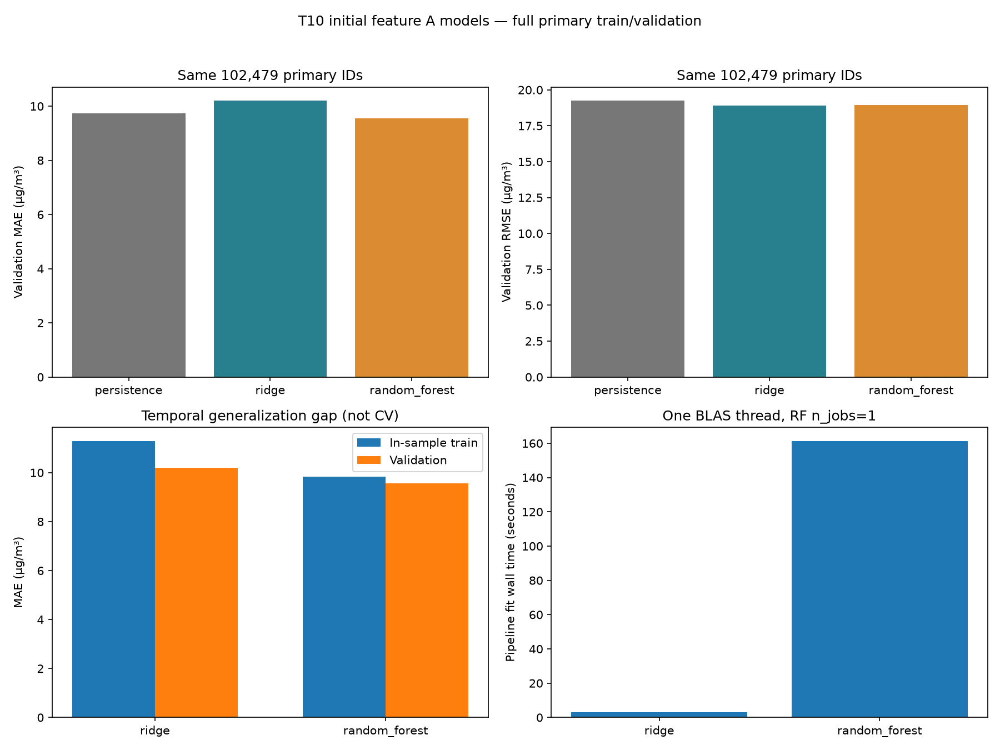

# T10 — Ridge và Random Forest ban đầu trên bộ A

Issue #20, nhánh `feature/t10-initial-regressors`; T09/PR #19 đã merge.
Mục tiêu: kiểm tra liệu các số đo hiện tại, khí tượng và lịch giúp dự báo
PM2.5 đúng t+1 so với persistence hay không. Không yêu cầu model phải thắng.
Chỉ dùng train/validation; không mở test, tuning hoặc thực hiện T11/T12.

## Thiết kế chốt trước khi chạy

- [Config T10](../configs/initial_models.json) và Issue #20 ghi trước metric:
  Ridge `alpha=1`, solver `auto`; RF `n_estimators=80`, `max_depth=12`,
  `min_samples_leaf=2`, `max_features=1`, `random_state=42`, `n_jobs=1`.
- Thiết kế RF cũ là 300 cây, depth không giới hạn, min leaf=1. Giới hạn T10
  theo RAM khả dụng lúc kiểm tra khoảng 1,9 GiB, chạy tuần tự, BLAS một luồng;
  không thử nhiều cấu hình rồi chọn theo validation. Giữ `default.json` để
  không đổi fingerprint T06/T07; từng run có effective config/actual parameters.
- Smoke: 256 primary train/64 primary validation đầu theo thời gian mỗi trạm,
  tổng 3.072/768 mẫu. Smoke chỉ kiểm thực thi, không dùng làm kết quả chính
  hoặc diễn giải chênh lệch với full như cải tiến.
- Full: **204.865 train/102.479 validation**, toàn bộ primary IDs T05, 12 trạm;
  primary yêu cầu PM2.5(t) và target quan sát. Không loại thêm mẫu vì feature
  khác thiếu, không impute target. Không phải toàn bộ raw hoặc operational cohort.
- Train target trước 2015-03-01, validation target từ 2015-03-01 đến trước
  2016-03-01; điều kiện nhãn sẵn có lúc fit kế thừa T05/T09. Quan sát đến origin
  t được dùng trong dự báo cuốn chiếu. Không fit lại trên validation.
- A có 20 cột theo T07: 11 số đo tại t, station/wd, giờ/tháng/thứ của t+1 và
  sin/cos giờ/tháng. `current_A` gọi builder T07 với origin quan sát cần dùng;
  B do builder chung tính ra được bỏ, không lưu/sử dụng. Cách gọi này chỉ hợp
  lệ cho A; thử B sau này phải dùng timeline T04 đầy đủ để giữ history.
- Dùng factory Pipeline T08: schema, numeric median + missing indicators,
  categorical missing + OHE unknown-ignore; Ridge scale numeric, RF không
  scale. Toàn bộ fit chỉ nhận X/y train primary. Cả hai cùng A/IDs, không clipping.
- Seed dự án 42; RF thực dùng 42, Ridge deterministic với `random_state=None`:
  log ghi đúng seed thực tế. Giới hạn một full run mỗi model sau smoke tương ứng.
- Không lưu model weights ở vòng này. Fitted summary ghi names, class/tham số
  thực, imputer/scaler/categories, coefficient/importances, hash đối tượng và
  số cây/độ sâu; **summary không phải model để load/inference**.

## Kết quả thực tế và nhận xét

Các run đều completed ngày 02/11/2026. Mỗi full chỉ chạy một lần; không có run
ML cũ trước T10 để tái sử dụng. Hai run persistence T09 được giữ nguyên.

| Model/mode | Run ID | Train/validation N | Dùng kết luận chính |
| --- | --- | --- | --- |
| Ridge smoke | `918f7e6185db4904a3362d44facca68d` | 3.072/768 | Không |
| RF smoke | `c3b4144a93c64bc1861f506fa4184f5d` | 3.072/768 | Không |
| Ridge full | `aec8630115714bb59d5c89c8a6b368c1` | 204.865/102.479 | Có |
| RF full | `780ecb7fb59d48bea58d5e4a076f1f26` | 204.865/102.479 | Có |
| Persistence T09 full tham chiếu | `24cef47874a94d9faa7bfcbae29b5c58` | Không ghi train/102.479 primary | Có |

[Bảng số đầy đủ](../reports/initial_models/comparison.csv) được sinh bằng
verifier từ artifact thật, không nhập metric bằng tay. MAE/RMSE đơn vị µg/m³,
R² không đơn vị. Train là lỗi in-sample, validation là dự báo cuốn chiếu.

| Model | Train MAE | Train RMSE | Train R² | Validation MAE | Validation RMSE | Validation R² |
| --- | ---: | ---: | ---: | ---: | ---: | ---: |
| Persistence | — | — | — | 9,736617 | 19,240919 | 0,944804 |
| Ridge A | 11,286320 | 19,923726 | 0,936180 | 10,200433 | 18,907140 | 0,946702 |
| Random Forest A | 9,837287 | 16,664335 | 0,955353 | 9,561488 | 18,964825 | 0,946376 |

Persistence T09 không ghi train metric hoặc cùng phép đo thời gian fit/predict
T10, nên bảng để NA, không tạo thêm baseline run hoặc điền số ước lượng.
Cả ba đạt coverage 100% trên cùng 102.479 primary IDs; không áp dụng kết luận
này cho operational cohort có PM2.5(t) thiếu. T09 operational metric vẫn được
giữ trong báo cáo riêng.

| Model | MAE validation − train | Fit pipeline (s) | Predict validation (s) | Trong logger (s) | Dự báo validation âm |
| --- | ---: | ---: | ---: | ---: | ---: |
| Ridge | −1,085887 | 2,963366 | 0,367864 | 10,532315 | 2.685 (2,620%) |
| RF | −0,275799 | 161,224743 | 1,232341 | 171,420858 | 0 |

Thời gian fit gồm preprocessing+estimator. Duration logger còn gồm predict
train, ghi/nén artifact và logging; không gồm preflight trước start_run
(Ridge 17,123853s, RF 15,985217s). Đây là wall time trên máy hiện tại, không
phải benchmark trên máy sạch; RF dùng một job/BLAS một luồng.



Hình gồm MAE/RMSE validation cùng IDs, MAE train–validation và chi phí fit;
nguồn là ba full run ở bảng trên. Hình không chứa smoke hoặc test.

- **Theo MAE chính**, RF giảm 0,175129 µg/m³ (**1,7987%**) so persistence;
  Ridge tăng 0,463815 (**4,7636%**). Đây là kết quả một split/config, chưa đủ
  kết luận cải thiện ổn định. Giữ persistence là mốc mạnh cho dự báo một giờ.
- Ridge có RMSE thấp nhất ba model (18,907140), dù MAE kém persistence.
  Do đó không tuyên bố một model thắng mọi tiêu chí. Ridge rẻ hơn RF trong
  lượt fit này, nhưng 2.685 dự báo âm bộc lộ hạn chế sử dụng trực tiếp.
  Giữ nguyên dự báo âm theo identity T08, không âm thầm clipping để làm đẹp metric.
- MAE validation thấp hơn train ở cả hai model. Điều này có thể liên quan độ
  khó khác nhau giữa giai đoạn/cohort; chưa chứng minh model không overfit.
  Với RF, RMSE lại tăng từ 16,664335 lên 18,964825 và R² giảm từ 0,955353 xuống
  0,946376: cần theo dõi lỗi lớn/chuyển giai đoạn, không chỉ nhìn gap MAE.
- RF là ứng viên tạm tốt nhất theo MAE trên A; Ridge là đối chứng tuyến tính
  rẻ và tốt hơn về RMSE. Chưa khóa model cuối, chưa có kiểm định bất định hay CV.
- Giả thuyết cho **T11 khi được giao**: kiểm độ ổn định bằng expanding-window
  train CV và ngân sách nhỏ cho depth/min leaf hoặc alpha, so cả MAE/RMSE/chi
  phí với cấu hình này. **T12 khi được giao**: A/B có thể cho biết lag/rolling
  giúp theo dõi xu hướng hay chỉ lặp thông tin PM2.5(t); selector phải fit trong
  fold. Đây là đề xuất, chưa chạy CV, thử B/C hoặc thay cấu hình sau metric.

## Truy vết và tái kiểm

[Runner](../scripts/run_initial_models.py), [module](../src/beijing_air/initial_models.py),
[verifier/report](../scripts/report_initial_models.py),
[CSV tổng hợp](../experiments/experiment_log.csv).
Mỗi run có config/metadata/metrics/notes, snapshot sáu file mã có SHA-256,
membership digest và predictions train/validation CSV.GZ chứa sample ID,
station, origin/target timestamps, y_true/y_pred/residual, split và run_id.
Không tạo ZIP mới; bốn thư mục T10 thật được allowlist trực tiếp trong Git.
Raw, ma trận feature, cache, môi trường và model lớn tiếp tục bị ignore.

```powershell
.\.venv\python.exe scripts/report_initial_models.py --write-comparison
.\.venv\python.exe -m pytest tests -q -k "not test_saved_full_output_matches_audit_and_raw_checksums" --basetemp=.pytest_cache/t10-check
```

Report không fit hoặc tạo run; nó kiểm mọi artifact checksum/size, CSV liên kết
config/metadata/metrics/notes, pipeline summary, T05 primary IDs đúng thứ tự,
y_true và metric tính lại từ predictions, rồi sinh bảng/hình. Lệnh `--run-id`
cho phép xác minh smoke riêng. Cần snapshot T05 train/validation đúng manifest
để kiểm cả membership; chỉ tính metric từ predictions không cần raw.

Clone mới: giữ CSV hiện tại sáu dòng và các thư mục T10 đã track. T09 run trees
vẫn ở bundle T09 có sẵn; dùng hướng dẫn restore trong `baseline_results.md`
nhưng giải nén vào thư mục tạm ignored rồi **chỉ chép hai run trees T09** vào
`artifacts/experiments/`. Không thay CSV hiện tại bằng index hai dòng cũ trong
bundle, không rebuild index khi thiếu tree. Không tạo run để giả lập lịch sử.
Sau restore, verifier T10 và logger dùng đủ sáu tree. Không đóng gói thêm.

Lệnh restore riêng cho clone T10 (workspace hiện tại đã đủ tree, không chạy):

```powershell
if ((Get-FileHash -LiteralPath 'reports/baseline/t09_runs.zip' -Algorithm SHA256).Hash.ToLower() -ne 'e9278afba5e1017f59fa11df38efe5ccd47b468fc6c3272e55f25ba59d06b5fb') { throw 'T09 bundle checksum mismatch' }
$t10Restore = Join-Path (Get-Location).Path 'artifacts/t10_restore_t09'
if (Test-Path -LiteralPath $t10Restore) { throw 'Chọn thư mục tạm trống.' }
Expand-Archive -LiteralPath 'reports/baseline/t09_runs.zip' -DestinationPath $t10Restore -ErrorAction Stop
foreach ($t09Run in @('5a6c965f64754a2ea9508e554fd92092','24cef47874a94d9faa7bfcbae29b5c58')) {
    $t09Destination = Join-Path 'artifacts/experiments' $t09Run
    if (Test-Path -LiteralPath $t09Destination) { throw 'Không ghi đè run đã có; dùng verifier.' }
    Copy-Item -LiteralPath (Join-Path $t10Restore "artifacts/experiments/$t09Run") -Destination $t09Destination -Recurse -ErrorAction Stop
}
```

## Kiểm tra và giới hạn

Local: **213 passed, 1 deselected**, gồm 13 tests T10 dùng fixture TEST_ONLY.
Ca T04 đọc raw/full bị loại vì có giai đoạn test. Tests bao gồm A bằng builder
T07 đầy đủ dù giờ khuyết, target không đổi feature, train/validation membership,
pipeline/fitted state, recompute/report, smoke/full budget, reuse không sinh run
mới, artifact bị đổi phải dừng và failure giữ metadata/history. Fixture không
vào CSV chính thức. Các kiểm tra train-only/save-load/unknown-category của
T08 vẫn pass; không kiểm load model thật vì không lưu weights.
Verifier bốn run T10 PASS: hashes/source snapshots, pipeline summary, log
links, IDs/order và metric tính lại từ predictions. Hình đã xem trực tiếp,
nhãn/đơn vị và bảng khớp artifact.
Sau khi bổ sung kiểm source snapshot và phép tính baseline cho report, đã chạy
lại riêng T10: **13 passed**. Repo chưa cấu hình GitHub Actions workflow;
các kết quả kiểm tra nêu trên là local, chưa kiểm CI/máy sạch.

Lúc smoke chạy liên tiếp, preflight RF dừng vì RAM trống dưới 768 MiB, trước
start_run/fit. Sau bộ kiểm tra kết thúc, chạy RF bằng tiến trình riêng, giữ
nguyên config/dữ liệu; không coi preflight này là một full run thất bại hoặc
bỏ lịch sử thực nghiệm. Không tự đóng app người dùng để lấy RAM.

Source được chạy trước commit nên Git metadata ghi trạng thái dirty thật,
không gán ngược commit tương lai; source snapshots/hash liên kết mã đã chạy.
Môi trường/thời gian đầy đủ ở metadata từng run. Chưa kiểm trên máy sạch hoặc
đánh giá độ bất định qua nhiều seed/fold, chưa có model triển khai. Validation
có điều kiện trên primary, không bảo đảm cho missing PM2.5(t) hoặc dữ liệu mới.
Chưa mở test, tuning, ablation B/C, demo hay tạo DOCX/PPTX. Codex hỗ trợ code,
kiểm tra và diễn giải; chưa xác minh đóng góp cá nhân của nhóm.
