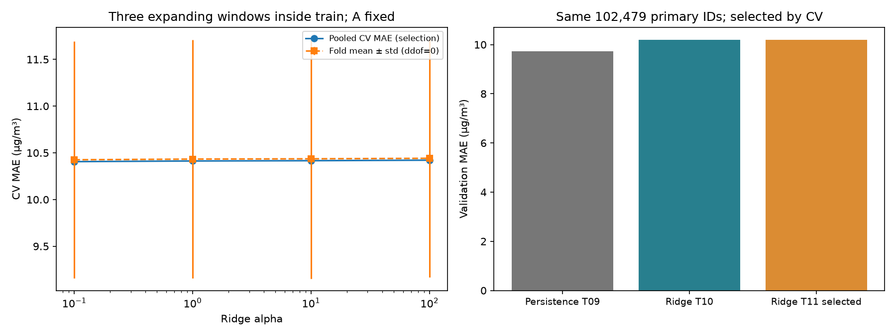

# T11 — Ridge A với expanding-window CV hữu hạn

Issue #22, nhánh `feature/t11-temporal-tuning`; T10/PR #21 đã merge.
Giữ nguyên lịch sử T09/T10 và giới hạn task: không test, RF tuning hoặc T12.

## Giả thuyết, tham chiếu và ngân sách chốt trước run

Tham chiếu Ridge T10 full `aec8630115714bb59d5c89c8a6b368c1`, alpha=1,
validation MAE=10,200433 kém persistence=9,736617 nhưng RMSE tốt nhất T10.
Giả thuyết: thay mức điều chuẩn có thể cải thiện khả năng dự báo qua thời
gian; chưa chứng minh Ridge overfit từ gap MAE âm, tuning không chắc cải thiện.

[Config](../configs/tuning.json) và Issue #22 được ghi trước khi chạy:

- Giữ A20 cột/primary cohort, factory T08 median/indicators/OHE/scaling Ridge,
  identity output, không clipping hoặc thay feature. Không impute target.
- Giữ grid T02 **alpha={0.1,1,10,100}**. Alpha1 là đối chứng trên cùng fold,
  không dùng validation để điều chỉnh grid. Chỉ tune Ridge: fit T10 khoảng3s
  so RF161s, RAM hạn chế; RF0fits, không tự bổ sung sau khi thấy kết quả.
- Full tối đa **4candidate×3fold=12 fit CV**, một refit cấu hình được CV chọn
  trên toàn train, một lần đánh giá validation. BLAS1, chạy tuần tự; không retry
  tự động, tăng grid hoặc giảm dữ liệu âm thầm khi thiếu tài nguyên.
- Smoke alpha1×3fold, đầu64fit/16eval primary mẫu mỗi trạm trong cửa sổ;
  mỗi fold 768/192 mẫu, không refit và không mở validation/test. Smoke kiểm
  thực thi, không dùng làm kết quả chính hoặc gọi là cải tiến từ smoke lên full.
- Project seed42, Ridge thực `random_state=None`, log ghi đúng giá trị này.

## Split theo thời gian và nhãn sẵn có

[Splitter](../src/beijing_air/temporal_cv.py) dùng unique target timestamps,
toàn bộ các trạm chung ranh giới, giữ ba cửa sổ `default.json` đã chốt từ T02:

| Fold | Evaluation targets [start,end) | Fit N sau purge | Eval N | Purged N | Target fit cuối | Origin eval đầu |
| --- | --- | ---: | ---: | ---: | --- | --- |
| 1 | 2014-06-01 → 2014-09-01 | 128.753 | 25.746 | 10 | 2014-05-31 22:00 | 2014-05-31 23:00 |
| 2 | 2014-09-01 → 2014-12-01 | 154.497 | 25.541 | 12 | 2014-08-31 22:00 | 2014-08-31 23:00 |
| 3 | 2014-12-01 → 2015-03-01 | 180.038 | 24.815 | 12 | 2014-11-30 22:00 | 2014-11-30 23:00 |

Số trên được lấy từ audit splitter trên snapshot train T05 thật, không hardcode
trong code kiểm tra. Cả fit/eval có12 trạm. Khóa station/time và sample ID duy
nhất; eval folds không giao nhau, tập fit mở rộng. Tổng **76.102 OOF IDs** cho
mỗi candidate hoàn thành; một sample không được chấm nhiều fold.

Fit dùng target `< min(eval.input_timestamp)` thực tế trên toàn trạm. Nhãn
target trùng origin đầu bị purge (khác nhau về N do primary/missing); không
chỉ trừ một dòng theo vị trí hoặc dùng random K-fold. Giờ khuyết không làm
lag nhảy sai nghĩa; A chỉ dùng origin quan sát và lịch t+1, không dùng nhãn.
Fold sau được dùng quan sát từng nằm trong eval fold trước khi chúng đã thành
quá khứ. Từng candidate/fold tạo Pipeline mới; median/scaler/vocabulary đều
fit lại trên phần fit sau purge. Không học preprocessing trên toàn train trước CV.

Chọn bằng **pooled MAE** trên toàn OOF (tổng absolute errors/tổng N), theo
protocol hiện có; báo thêm mean/std ddof0 của MAE/RMSE/R² theo fold. Pooled
RMSE/R² tính trực tiếp từ OOF, không lấy mean R² làm metric chọn. Nếu một fold
R² không xác định, mean/std R² là null kèm số fold xác định; không tự điền0/1.
Tie trong1e-12 chọn alpha lớn hơn. Candidate thiếu một fold completed bị loại;
thất bại/error vẫn được log, không chọn dựa vào phần fold còn lại.

Selection JSON ghi candidate/alpha/score và UTC timestamp **trước** lần gọi
loader validation/refit; validation không tham gia `choose_candidate`.
Sau đó refit mới trên toàn **204.865 primary train**, đánh giá **102.479 primary
validation IDs** T09/T10, coverage đầy đủ. Holdout T05 cho nhãn fit ở origin
được xem đã sẵn sàng (<=); purge nghiêm ngặt (<) áp dụng riêng CV như protocol.
Không dùng validation chọn lại alpha sau khi chấm cấu hình thắng CV.

## Kết quả tuning thực tế

Smoke parent: `90f6a2ef7f9d4a41b8570ae09d669c57`; full parent: `c895894bcf5a4ff28982fbb1ca9d69d9`.
Selected refit: `32e65c5a4cbc489c905cf146b743867f`. Full có18 hồ sơ (search1,
candidate4, fold12, refit1); smoke có5. Tất cả23 hồ sơ T11 completed, không có
failed candidate thật; lỗi được tiêm kiểm tra chỉ ở fixture TEST_ONLY.
Index29 dòng giữ nguyên sáu run T09/T10, không coi29 dòng là29 model.

| Alpha | Pooled CV MAE | Pooled CV RMSE | Pooled CV R² | Fold MAE mean ± std | Tổng fit CV (s) |
| --- | ---: | ---: | ---: | --- | ---: |
| 0.1 (chọn) | 10,405534 | 18,080608 | 0,946994 | 10,425491 ± 1,268015 | 4,393076 |
| 1.0 | 10,412704 | 18,086351 | 0,946960 | 10,432820 ± 1,278168 | 4,127322 |
| 10.0 | 10,415655 | 18,088943 | 0,946945 | 10,435821 ± 1,281371 | 3,546879 |
| 100.0 | 10,421272 | 18,091901 | 0,946928 | 10,441349 ± 1,275715 | 4,478128 |

Mean/std RMSE và R² đầy đủ ở [candidates.csv](../reports/tuning/candidates.csv);
metric/N/thời gian/run ID từng fold ở [fold_metrics.csv](../reports/tuning/fold_metrics.csv).
CV cùng76.102 OOF IDs/candidate. Alpha0.1 chọn theo pooled MAE;
không chọn lại bằng mean/std hoặc score validation.

| Model | Validation N | MAE | RMSE | R² | Dự báo âm |
| --- | ---: | ---: | ---: | ---: | ---: |
| Persistence T09 | 102479 | 9,736617 | 19,240919 | 0,944804 | 0 |
| Ridge T10 | 102479 | 10,200433 | 18,907140 | 0,946702 | 2685 |
| Ridge T11 selected | 102479 | 10,200529 | 18,907198 | 0,946702 | 2684 |

[Bảng trước–sau](../reports/tuning/before_after.csv) tính lại từ predictions,
kiểm cùng IDs/thứ tự và checksum. MAE/RMSE µg/m³, R² không đơn vị.



Hình trái: pooled CV MAE dùng chọn và fold mean±std ddof0 (mô tả biến thiên,
không phải confidence interval). Hình phải: validation cùng102.479 primary
IDs persistence T09, Ridge T10 và selected Ridge T11, không smoke/test.

- CV cải thiện rất nhỏ: alpha0.1 MAE10,405534 so alpha1 10,412704,
  giảm0,007170 µg/m³; std giữa fold khoảng1,27 lớn hơn nhiều chênh lệch này.
  Không diễn giải std như kiểm định độc lập hoặc bằng chứng cải thiện chắc chắn.
- Validation chưa cải thiện: MAE10,200529 tăng0,000096837 so T10;
  RMSE18,907198 tăng0,000057438. Sai khác rất nhỏ nhưng vẫn ghi đúng,
  không đổi alpha bằng validation hoặc mở rộng grid vì thắng ở biên0.1.
- Persistence vẫn tốt hơn về MAE9,736617. RF A T10 vẫn là ứng viên tốt nhất
  theo MAE9,561488 trong các full validation đã chạy; chưa RF tuning T11.
- Selected refit train MAE11,286262/RMSE19,923719/R²0,936180; MAE validation
  thấp hơn train không chứng minh không overfit. Có2.684 dự báo âm giữ nguyên
  theo identity chung; giảm một dự báo âm so T10 chưa là cải thiện thực tiễn.
- Tổng fit12 CV khoảng16,545404s, selected fit1,771478s; predict validation
  0,413035s. Parent full wall time65,767846s gồm logging/nén/ghi artifact và
  selected refit, không gồm preflight load/check train trước start_run. Môi trường
  chưa phải máy sạch; không coi chênh thời gian T10/T11 là hiệu ứng alpha.
- Quyết định: giữ kết quả bất lợi, chưa thay mô hình cuối hoặc buộc tuning thắng.
  Giả thuyết điều chuẩn trong grid này chưa giúp validation; A/tuyến tính có thể
  là giới hạn, chưa chứng minh nguyên nhân. Đề xuất T12 A/B khi được giao;
  chưa làm feature selection, chạy RF grid hoặc mở test.

## Code, log và tái kiểm

[Module search](../src/beijing_air/tuning.py), [CLI](../scripts/run_tuning.py),
[verifier/report](../scripts/report_tuning.py), [index](../experiments/experiment_log.csv).
Tái sử dụng logger; `kind=tuning` cho search/candidate/fold, `kind=train` cho
selected refit, phân biệt bằng `parameters.stage`. Không tạo schema/logger
song song. Hierarchy search→candidate→fold, và search→selected refit; tất cả
tham chiếu run Ridge T10. Mỗi run có config/metadata/metrics/notes và status/error.
Search lưu source snapshots SHA, fold counts/time/membership digests, toàn bộ
candidate/fold IDs và selection khóa trước validation. Fold lưu eval predictions
CSV.GZ, fitted state summary và thời gian fit/predict; refit lưu train/validation
predictions. Summary không phải đối tượng model để load/inference, không lưu
weights/pipeline serialized, không tạo ZIP mới.

```powershell
.\.venv\python.exe scripts/run_tuning.py --mode smoke
.\.venv\python.exe scripts/run_tuning.py --mode full
.\.venv\python.exe scripts/report_tuning.py --write-report
.\.venv\python.exe -m pytest tests/test_tuning.py -q --basetemp=.pytest_cache/t11-check
.\.venv\python.exe -m pytest tests -q -k "not test_saved_full_output_matches_audit_and_raw_checksums" --basetemp=.pytest_cache/t11-regression
```

Runner reuse completed cùng source/config/data signature sau khi kiểm artifact,
không fit lại hoặc thêm dòng log. Full khác config hoặc sau full thất bại bị
chặn bởi budget; không xóa lịch sử để vượt giới hạn. Verifier không fit, kiểm
hierarchy, checksum/source/CSV links, sample IDs/folds/purge, median/scaler tính
lại từ fit rows, metric OOF/mean/std, lựa chọn CV và selected validation cùng IDs.
Clone mới có trực tiếp các run T10/T11 đã track; restore riêng hai tree T09 từ
bundle có sẵn theo [hướng dẫn T10](initial_findings.md), giữ index hiện tại,
không chép đè bằng CSV sáu/hai dòng cũ hoặc rebuild khi thiếu tree.

## Kiểm tra đã chạy

Riêng T11 **18 passed** sau khi tích hợp verifier, gồm splitter hai trạm,
giờ khuyết, timestamp grouping bất biến khi đảo dòng, purge/overlap/empty và
station coverage; thay holdout X/y không đổi fitted state; pooled metric,
mean/std/R² null và tie-break; full thiếu smoke bị chặn; reuse không thêm dòng;
failed candidate/fold giữ error, candidate thiếu fold bị loại, tất cả candidate
lỗi không được refit/đọc validation. Fixture đánh dấu TEST_ONLY, không vào log
chính thức. Lần đầu có ba lỗi tích hợp do dùng kind ngoài enum logger; đã đổi
sang kind hiện có và parameters.stage, giữ logger/schema cũ, sau đó pass.

Regression cuối **231 passed, 1 deselected** với lệnh ở trên. Ca T04 đọc raw/full
có phần test bị loại đúng phạm vi. Smoke verifier và full verifier đều PASS:
23 hồ sơ thật đủ hierarchy/hashes/CSV links, source snapshots, fold/fit IDs,
median/scaler train-only, metric tính lại và selection trước refit. Hình đã xem
trực tiếp và khớp bảng artifact. Chưa cấu hình CI, kết quả nêu trên là local.

Một lần preflight smoke lúc tests còn chạy dừng vì RAM dưới768 MiB, trước
start_run/fit; chạy tiến trình riêng sau khi tests giải phóng RAM, không đổi
grid hoặc dữ liệu. Không thêm bản ghi giả cho preflight, không đóng app người dùng.

## Giới hạn

Đây là tuning một họ với bốn alpha trên A và ba cửa sổ cố định; chưa tune RF,
khảo sát B/C, chạy nhiều seed hoặc đánh giá độ bất định thống kê. Tập primary
cần PM2.5(t) quan sát và target có thật; chưa bảo đảm cho operational/missing.
Chưa mở test, thực hiện T12, lưu model triển khai, tạo DOCX/PPTX hoặc kiểm máy
sạch. Source chạy trước commit ghi Git dirty thật; giữ source SHA thay vì gán
ngược commit tương lai. Môi trường/thời gian thực ở metadata. Codex hỗ trợ mã,
kiểm tra và nhận xét; không tự suy tên/đóng góp của thành viên.
